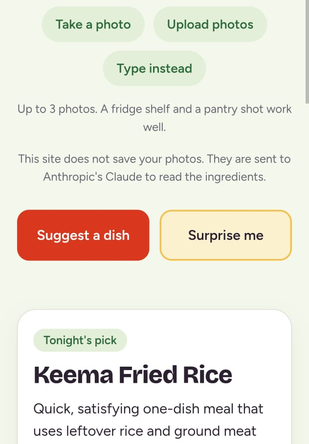
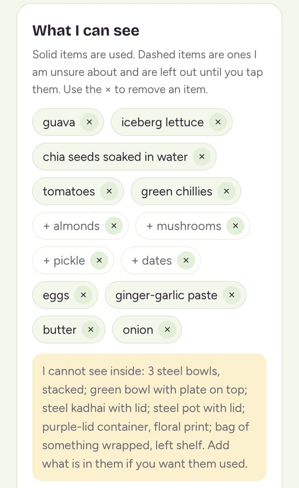
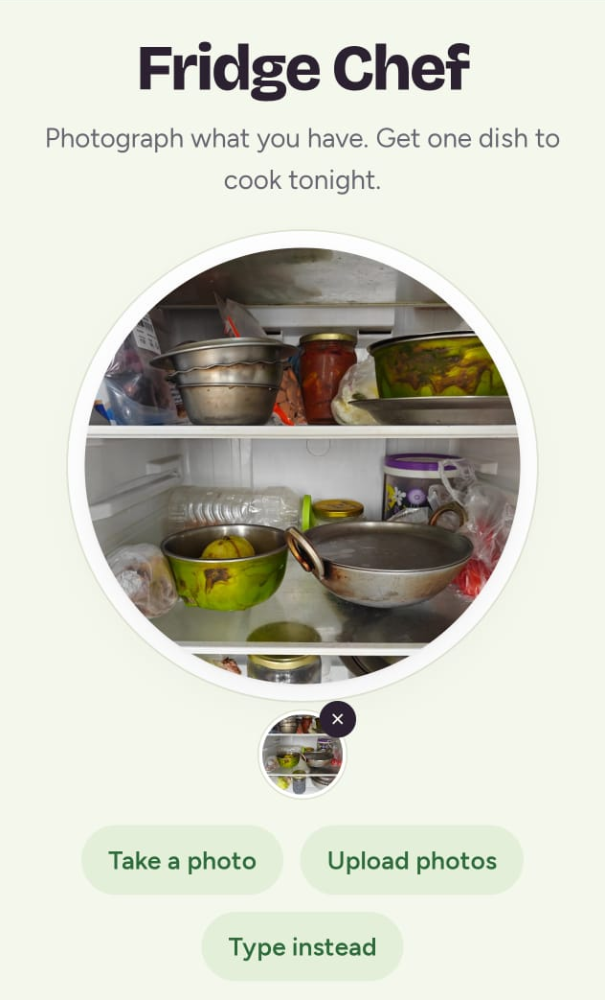
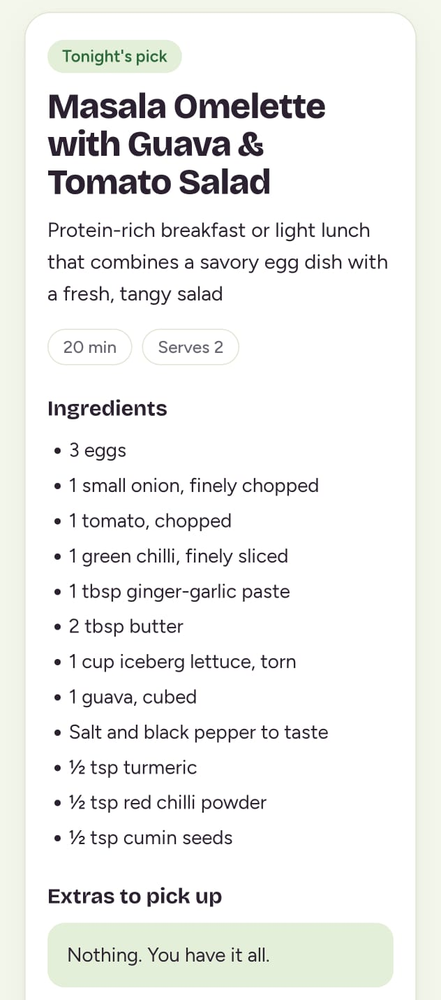

# Fridge Chef

Photograph your fridge. Get one dish to cook tonight. The app tells you what it could not see and lets you correct the list before it cooks.

**Live demo:** https://fridge-chef.technoelogy.workers.dev

## Why this is worth a look for consumer health teams

If your product reads a photo of a pack, a label or a strip, the safest move is to show what was unclear and let the person correct it before the tool acts. Fridge Chef is a small working example of that pattern: read, correct, then act.

It is a cooking tool, not a health tool. The link to consumer health is a hunch about trust, not a finding.

## What it does

1. You add up to 3 photos of a fridge, shelf or pantry.
2. It lists what it is sure of, marks unsure items as dashed and leaves them out, and names closed containers it cannot see inside.
3. You switch items on or off, add what is in the containers (quick-add chips for common Indian staples), then ask for a dish.
4. It suggests one stovetop dish with ingredients, extras to buy and a step-by-step method. "Surprise me" gives a more creative pick.

## Screenshots

| First attempt: guessed what was inside | What it can see, and what it cannot |
| --- | --- |
|  |  |

| The fridge | The dish |
| --- | --- |
|  |  |

## How it works

- The browser resizes each photo to 1200 px and sends it to a small Cloudflare Worker.
- The Worker holds the API key as a secret, applies fixed prompts and daily limits, and calls the Anthropic API twice: once to read the photos, then once to write the dish from the list you confirmed.
- Models: `claude-sonnet-5-5` reads photos, `claude-haiku-4-5-20251001` writes the dish. Both are set in `wrangler.toml`.

## Run it yourself

You need Node.js, a free Cloudflare account and an Anthropic API key.

```
npx wrangler login
npx wrangler kv namespace create RATE
```

Paste the printed id into `wrangler.toml`, then:

```
npx wrangler secret put ANTHROPIC_API_KEY
npx wrangler deploy
```

## Limits and safety

- The key never appears in the page or the repo. Prompts are fixed on the server.
- Defaults: 20 calls per IP per day and 100 across everyone, set in `wrangler.toml`.
- Set a monthly spend limit in the Anthropic Console before sharing a link.
- Photos are not saved by this site. They are sent to Anthropic's Claude to read the ingredients.

## Status

Live and working. Photo-reading accuracy is still being scored, and the reading varies from run to run, which is why the list is editable. Known gap: no automated tests for the page beyond local simulation.

## License

MIT. See LICENSE.
